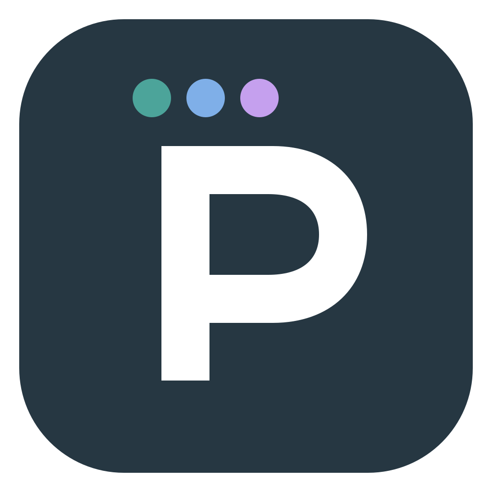

<p align="center"></p>
<h1 align="center">PromptBeacon</h1>
<p align="center"><strong>Know before you prompt.</strong><br>A color for your model. A signal for your effort.</p>
<p align="center"><a href="https://github.com/Tengify/promptbeacon/releases">Download</a> · <a href="website/">Landing page</a> · <a href="docs/TESTING.md">Testing</a> · <a href="SECURITY.md">Security</a> · MIT</p>

A local Rust + Tauri 2 tray utility for **macOS, Windows, and Linux**. A click-through border, tint, or corner badge tells you which model and reasoning effort are selected in the focused Codex or Claude Code session, before sending the next prompt.

New sessions can inherit a powerful model you didn't mean to use. Resumed sessions can carry a forgotten effort level. PromptBeacon makes those selections visible at a glance.

## Features

- Editable model colors, with specific matching rules taking priority.
- Actual effort labels and five-bar notation. Missing effort stays unavailable.
- Border + badge, subtle tint + badge, or badge only. Three corner positions.
- Focus-preserving, click-through overlay and native tray pause/resume controls.
- macOS Accessibility, Windows UI Automation, Linux AT-SPI/X11 adapters.
- Optional Claude Code terminal status-line integration with fresh session binding.
- Local settings. No account, model requests, screenshots, prompt reads, or telemetry.

The [interactive landing page](website/) uses synthetic sessions and generic model names. No real session, screenshot, diagnostic, or machine configuration is included in this repository.

## Installation

Download a package and its SHA-256 checksum from [Releases](https://github.com/Tengify/promptbeacon/releases). The initial release is a preview; platform builds do not imply certification against every app version or window manager.

**macOS:** unzip and move PromptBeacon.app to Applications. Enable PromptBeacon in System Settings → Privacy & Security → Accessibility. Preview builds are ad-hoc signed rather than notarized by an Apple Developer certificate. If macOS blocks the app, use Apple's standard Privacy & Security approval for an app you chose to download. Rebuilding or replacing an ad-hoc signed app may require re-adding its Accessibility entry.

**Windows:** extract the portable ZIP and launch PromptBeacon.exe. Windows 10/11 x64 and Microsoft Edge WebView2 Runtime are required. The package is not signed with a commercial developer certificate. Detection cannot inspect elevated applications from a non-elevated process.

**Linux:** install the `.deb` on Debian 12+ or a compatible Ubuntu release. The package declares WebKitGTK 4.1, GTK 3, libxdo, and appindicator runtime dependencies. Other distributions/architectures can build locally. Enable desktop accessibility (AT-SPI); Electron apps may need `--force-renderer-accessibility`. X11 supports window geometry. Wayland uses a floating badge with placement controlled by the compositor.

Open **Beacon → Test overlay** to check the indicator. Open a supported coding session, focus its prompt, and compare the badge to its model/effort selectors. The overlay shows the active window; it does not color sidebar entries or modify the host application.

## Detection behavior

Only current selection-like controls are authoritative. Unknown, open menus, conflicting pickers, and incomplete scans produce a neutral state. Unavailable effort shows no filled bars, while a detected model can still provide its color. Transcript/editor text and global defaults are not used as fallbacks. Application UI changes and localization may need adapter updates.

| Platform | Build | Runtime validation |
| --- | --- | --- |
| macOS Apple Silicon + Intel | Local universal app | Live picker/window-manager tests required for each app version |
| Windows x64 | Local cross-build | Native Windows desktop test still required |
| Linux x64 | Local Docker build | Desktop AT-SPI/X11/Wayland test still required |

See [verification](docs/VERIFICATION.md) for measured evidence and limits, and [architecture](docs/ARCHITECTURE.md) for detection and lifecycle boundaries.

## Claude Code in a terminal

Copy the generated snippet from **Connections** and merge its `statusLine` property into your Claude Code settings, preserving unrelated settings. It replaces an existing status-line command. `refreshInterval: 1` refreshes idle selections. The installed executable's `--statusline --terminal-title` mode runs without starting the GUI.

The bridge stores only validated session ID, model, effort, and timestamp. The terminal title marker links the event to the current tab/window. Events expire after 3.5 seconds without refresh; expired files are periodically removed. Title updates and active-tab titles must be exposed by the terminal. Run Claude Code and PromptBeacon locally on the same computer; remote SSH/WSL sessions do not automatically share host storage. Omit `--terminal-title` for a colored status line without window binding.

## Build locally

Install Node.js 22+, Rust 1.99+, and [Tauri prerequisites](https://tauri.app/start/prerequisites/).

```sh
git clone https://github.com/Tengify/promptbeacon.git
cd promptbeacon
npm ci
npm run app:dev
```

```sh
npm run check:local
node scripts/cargo.mjs fmt --manifest-path src-tauri/Cargo.toml --check
npm run app:build
npm run site:build
```

The wrappers use an ignored `.tools/` Rust installation when present, otherwise your system Rust. Release builds optimize for size, use whole-program LTO, strip symbols, and remap source/home paths. No Node.js runtime or browser engine is bundled with the app.

**No GitHub Actions workflows.** Builds, reviews, packaging, and publication run locally. See [contributing](CONTRIBUTING.md) and [release instructions](docs/RELEASING.md). UI smoke tests use a locally installed Playwright Chromium browser; the scripts never publish their screenshots.

## Landing page

```sh
npm run site:dev
npm run site:test
npm run site:build
```

Preview at `http://127.0.0.1:4317`. The download button detects the desktop OS and says “Download for macOS”, “Download for Windows”, or “Download for Linux”. Mobile/unknown clients get a chooser. Deploy `website/dist/` manually to any static host; no server runtime, analytics, or third-party fonts are needed.

## Diagnostics

Connections can copy the last scan's model/effort labels and counters. Inspect and redact these before sharing. `--diagnostics` reads the bounded local report; `--probe` checks the current focused app. Do not publish diagnostic files or actual session data. Report issues with a minimal dummy reproduction instead. `PROMPTBEACON_DATA_DIR` can isolate development storage.

PromptBeacon is an independent project, not affiliated with OpenAI or Anthropic.
